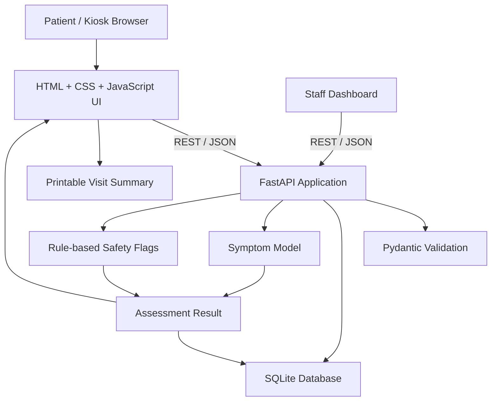

# DigiChikitsak — AI-Assisted Community Health Kiosk

> **Project type:** Student proof of concept (PoC)  
> **Team:** TeamDiamonds  
> **Safety notice:** DigiChikitsak is an educational prototype. It is not a clinically validated medical product, medical device, or diagnostic service. Vital readings and OTP/device integrations may be simulated.

## 1. Team details

- **Team name:** TeamDiamonds
- **Team member:** Shrinkhala Anand
- **Team member:** Vaidik Gupta
- **Institution:** Kalinga Institute of Industrial Technology (KIIT), Bhubaneswar, Odisha, India
- **Incubator / accelerator:** No affiliation claimed. Add an official incubator only if the team is formally associated with one.
- **Contact email:** Add a team-controlled contact email before public submission.

## 2. Project title

**DigiChikitsak: A Multilingual, Accessible, AI-Assisted Community Health Kiosk**

## 3. Problem statement

People visiting community clinics and primary-care facilities may face barriers when beginning a consultation: intake information can be incomplete or fragmented, symptom histories may be captured inconsistently, and healthcare staff may need to repeat basic questions before they can assess the patient. Language and accessibility barriers can add further friction. A lightweight guided intake system could help patients organise their symptoms and basic health information in a consistent format before speaking with a qualified healthcare professional.

This project explores a digital kiosk workflow for collecting a demo patient profile, symptoms, and basic vital-sign values, then presenting a structured, printable visit summary. It does **not** replace a clinician or claim to diagnose disease.

## 4. Proposed solution

DigiChikitsak provides a friendly, multilingual-inspired kiosk interface with a female clinician illustration and a guided patient journey:

1. **Welcome and access:** patient login, new registration, or guest flow. OTP is explicitly simulated.
2. **Patient profile:** capture a name (for registration), age, gender, and optional mobile number.
3. **Symptoms:** select common symptoms and optionally describe another symptom.
4. **Vitals and assessment:** enter or review demo vital-sign values and submit a structured assessment.
5. **AI/ML-assisted pattern matching:** a local model provides an exploratory symptom-pattern result. Rule-based safety flags can surface concerning values or symptoms.
6. **Care guidance and report:** display general next-step guidance and a visit summary that can be printed or reviewed by staff.
7. **Staff view:** browse demo patient records and past assessments through the staff dashboard.

The current implementation is a proof of concept. Real clinical devices, real OTP delivery, telemedicine, and production-grade security are not included.

## 5. Healthcare use case

**Primary use case:** a patient at a community health centre uses a kiosk to record symptoms and basic health information before a consultation. Staff can review the structured information and printed summary to support the conversation.

**Potential users:** patients, community health workers, clinic reception staff, and healthcare professionals reviewing the intake summary.

**Expected prototype value:** a consistent intake flow, less repetitive manual data capture, accessible visual guidance, and a reusable record of the demo visit. These are intended benefits, not measured clinical outcomes.

## 6. Features

- Responsive, teal-and-white welcome/login experience inspired by the supplied UI reference.
- Friendly female doctor illustration, healthcare feature tiles, ECG motif, privacy card, and safety disclaimer.
- Patient Login and New Registration tabs.
- Patient lookup by patient ID or mobile number through the API.
- Guest path for a demo health check.
- Age entry and multi-select symptom intake.
- Optional free-text symptom description.
- Patient and assessment persistence in local SQLite.
- AI/ML-assisted symptom-pattern result and rule-based safety flags.
- Demo vital signs including temperature, SpO₂, blood pressure, weight, and height/BMI.
- Printable assessment summary.
- Staff dashboard and REST API documentation.
- English-first interface with visible language/theme/large-text affordances. Full translation and real authentication should be validated before deployment.

## 7. Technical stack

| Layer | Technology | Purpose |
|---|---|---|
| Frontend | HTML5, CSS3, vanilla JavaScript | Kiosk UI, form flow, responsive layout |
| Backend | Python, FastAPI | REST endpoints and application logic |
| Validation | Pydantic | Validate patient and assessment payloads |
| Database | SQLite | Store demo patient profiles and assessments locally |
| AI/ML | scikit-learn, pandas, NumPy, joblib (see `requirements.txt` and `app/ml.py`) | Train/load a prototype symptom-pattern model |
| Data | CSV files in `data/` | Prototype symptom and virtual-patient data |
| Testing | pytest, FastAPI TestClient | API smoke tests |
| Deployment | Uvicorn, optional Docker / Docker Compose | Local development and containerized run |
| Documentation | Markdown, PDF | Architecture, demo script, and presentation |

Check `requirements.txt`, `app/ml.py`, and `train_models.py` for the exact installed package/model configuration.

## 8. AI/ML model and framework

The repository includes `train_models.py`, `app/ml.py`, a prototype dataset, and a serialized model under `models/`. The model is intended for demonstration of symptom-pattern classification only. Rule-based safety flags are handled separately from the model output.

- **Framework:** Python and scikit-learn-based workflow (see source for exact estimator and preprocessing).
- **Inputs:** selected symptoms and structured demo fields.
- **Outputs:** exploratory pattern/category and supporting explanation where available.
- **Safety boundary:** output is not a diagnosis, cannot establish a disease, and must not be used to make treatment decisions.
- **Dataset limitation:** included data are prototype/reference data, not a representative clinical cohort. Do not interpret model metrics as clinical performance.
- **Reproducibility:** run `python train_models.py` to regenerate the local model.

Before any real-world use, the model would require appropriately governed clinical data, expert review, bias evaluation, calibration, external validation, privacy/security review, and regulatory assessment as applicable.

## 9. Architecture



A polished PDF diagram is included at `docs/architecture_diagram.pdf`.

## 10. Project structure

```text
DigiChikitsak/
├── app/
│   ├── main.py                 # FastAPI routes and business logic
│   ├── schemas.py              # Request validation models
│   ├── db.py                   # SQLite connection/schema
│   ├── ml.py                   # Model loading/prediction/safety flags
│   └── static/
│       ├── index.html          # Main kiosk + welcome/login experience
│       ├── styles.css          # Shared style sheet
│       ├── app.js              # Patient/assessment flow scripts
│       ├── staff.html          # Staff dashboard
│       ├── staff.js            # Staff dashboard scripts
│       └── assets/doctor-lady.png
├── data/                       # Prototype datasets/reference notebook
├── models/                     # Trained model and model card
├── docs/
│   ├── architecture_diagram.pdf
│   ├── project_presentation.pdf
│   ├── DEMO_VIDEO_SCRIPT.md
│   ├── DATASET_NOTES.md
│   └── ARCHITECTURE.md
├── tests/test_api.py
├── train_models.py
├── requirements.txt
├── Dockerfile
├── docker-compose.yml
├── LICENSE
└── README.md
```

## 11. Run locally on Windows

Open PowerShell in the extracted project directory that contains `requirements.txt`.

```powershell
py -m venv .venv
.\.venv\Scripts\Activate.ps1
python -m pip install --upgrade pip
python -m pip install -r requirements.txt
python train_models.py
uvicorn app.main:app --reload
```

Open:

- Kiosk: <http://127.0.0.1:8000/>
- Staff dashboard: <http://127.0.0.1:8000/staff>
- Interactive API docs: <http://127.0.0.1:8000/docs>
- Health endpoint: <http://127.0.0.1:8000/api/health>

If PowerShell reports `Operation cancelled by user`, the install was interrupted. Run only the command itself and let it finish; do not paste terminal output back into PowerShell.

### Run tests

```powershell
python -m pytest -q
```

### Optional Docker run

```powershell
docker compose up --build
```

## 12. API overview

| Method | Endpoint | Purpose |
|---|---|---|
| `GET` | `/api/health` | Service health and prototype mode |
| `POST` | `/api/patients` | Create a demo patient |
| `GET` | `/api/patients` | List/search demo patients |
| `GET` | `/api/patients/lookup?identifier=...` | Find by patient ID or mobile |
| `GET` | `/api/patients/{patient_id}` | Retrieve patient and assessment history |
| `POST` | `/api/assessments` | Save assessment and return prototype result |

See `/docs` for live request schemas and responses.

## 13. Privacy, security, and safety

- Use fictional/demo information only.
- SQLite data is local to the machine unless the deployment is changed.
- OTP is simulated; the application does not send an SMS.
- Device readings may be simulated or manually entered.
- Do not expose the demo database or API publicly with real patient information.
- Production deployment would require authentication, authorisation, encrypted transport, secure secrets, audit logging, retention/deletion policies, threat modelling, and a privacy/legal review.
- If a user reports severe symptoms or an emergency, the UI must direct them to local emergency services/qualified care; an ML result must never delay care.
- This software does not provide diagnosis, treatment, or medical advice.

## 14. Demo video (required for submission)

**Unlisted YouTube demo URL:** `ADD_REAL_UNLISTED_YOUTUBE_URL_HERE`

The URL is intentionally a placeholder; no video has been uploaded from this repository. Record a 15–20 minute demo, upload it as **Unlisted**, test the link in a private/incognito browser, and replace the placeholder above. A time-coded recording plan is in `docs/DEMO_VIDEO_SCRIPT.md`.

Suggested demo sequence: project purpose and safety boundary → welcome/login → new registration/guest → age and symptoms → vitals and assessment → result/safety flags → printable report → staff dashboard → architecture/API/ML explanation → limitations and roadmap.

## 15. Open-source license

This project is distributed under the **MIT License**; see [`LICENSE`](LICENSE). Confirm that MIT matches the event's submission requirements and that the team has permission to publish all included assets/data.

## 16. Architecture and presentation files

- UI reference image: [`docs/ui_reference.png`](docs/ui_reference.png)
- Architecture diagram: [`docs/architecture_diagram.pdf`](docs/architecture_diagram.pdf)
- Project presentation: [`docs/project_presentation.pdf`](docs/project_presentation.pdf)
- Demo recording plan: [`docs/DEMO_VIDEO_SCRIPT.md`](docs/DEMO_VIDEO_SCRIPT.md)
- Dataset notes: [`docs/DATASET_NOTES.md`](docs/DATASET_NOTES.md)

## 17. Public submission checklist

- [ ] Replace `ADD_REAL_UNLISTED_YOUTUBE_URL_HERE` with the real 15–20 minute unlisted demo URL.
- [ ] Add a team contact email.
- [ ] Review the team member names and institution wording.
- [ ] Upload the repository to the team's public Git hosting location if required.
- [ ] Verify README links, video access, PDFs, and repository access in a signed-out/private browser.
- [ ] Do not claim clinical accuracy, measured outcomes, device integration, or incubator endorsement unless verified.
- [ ] Review licensing for all images, datasets, and third-party packages before publishing.

## 18. Roadmap

1. Complete end-to-end integration between entry flow, patient profile, symptom selection, assessment, and report.
2. Add proper localisation and keyboard/screen-reader accessibility testing.
3. Add authenticated staff accounts and role-based access control.
4. Integrate validated devices only after hardware/API testing.
5. Conduct clinical, privacy, security, and model validation with qualified experts before considering any real-world deployment.

---

**Built by TeamDiamonds — Shrinkhala Anand and Vaidik Gupta.**

## Patient Journey (single-entry flow)

The welcome screen collects the patient identifier once, then age and symptoms once. The same values carry into the kiosk; no duplicate patient-ID, age, or symptom prompt is shown in the same session. OTP and QR features are simulated.
